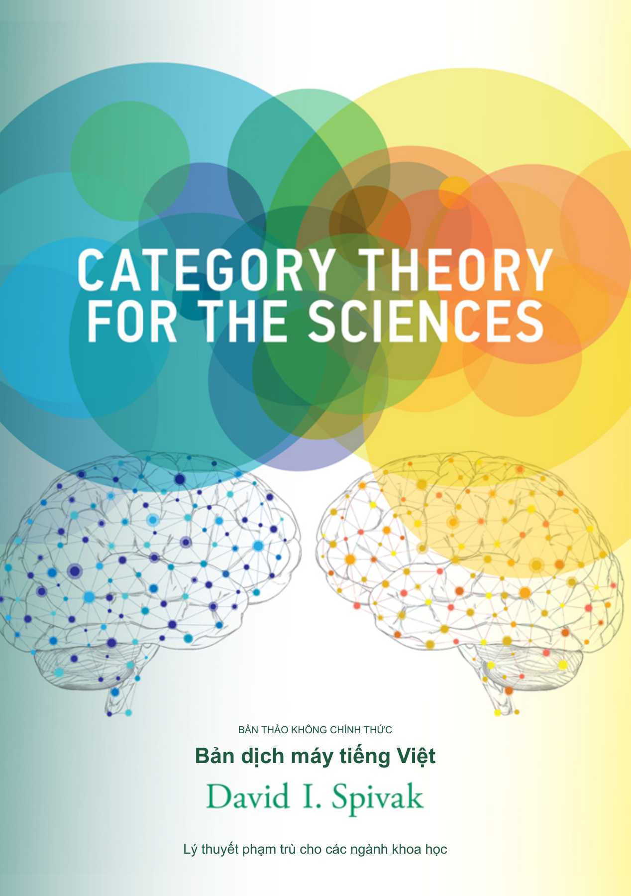

# Category Theory for the Sciences - Vietnamese machine translation

[Tiếng Việt](README.md)

**[Machine Translated, Not Reviewed]**

This machine translation has not been reviewed by a human. Recorded AI-assisted
and technical checks are described separately in [the review record](docs/REVIEW.md).

A [XanclockTranslations](https://github.com/XanclockTranslations) project:
[repository](https://github.com/XanclockTranslations/category-theory-sciences-vi) ·
[report an issue or suggest a correction](https://github.com/XanclockTranslations/category-theory-sciences-vi/issues).

An unofficial Vietnamese machine-translation draft of David I. Spivak's
*Category Theory for the Sciences* (The MIT Press, 2014).
[Original book and publisher information](https://mitpress.mit.edu/9780262028134/category-theory-for-the-sciences/).

The draft covers the supplied edition's opening material, all seven chapters,
exercises and available solutions, diagrams, tables, references, and index.
AI model: **GPT-6.1 Sol (Ultra)**. Prompting: **Bế Trọng Nghĩa (@ichxorya)**.
The translation still needs proofreading by people familiar with category theory.

[Read the 463-page Vietnamese PDF](output/pdf/category-theory-sciences-vi-machine.pdf).
The translated index contains 566 entries and maps 605 original page references
to the Vietnamese pages. Review status and the limits of the recorded checks
are described in [docs/REVIEW.md](docs/REVIEW.md).

## Editable sources

- [translation/](translation/) contains the LaTeX text, index data, and assets.
  Native TikZ diagrams and the cover's vector lettering remain editable.
- [source/original.pdf](source/original.pdf) preserves the supplied source book;
  [source/manifest.json](source/manifest.json) records its hash and page mapping.
- [tools/](tools/) contains scripts for assembly, building, index generation,
  rendering, auditing, cover preparation, and source packaging.
- [TRANSLATION_GUIDE.md](TRANSLATION_GUIDE.md) records translation conventions
  and the shared terminology.

## Build

Use Python 3.12 or newer, Tectonic on `PATH`, and the dependencies in
[requirements.txt](requirements.txt): Pillow 12.3.0 and pypdf 6.10.0.
Poppler (`pdftoppm` on `PATH`) is optional for rendering pages for visual review.
Tectonic's first build may download its standard TeX bundle.

The build uses twelve Times New Roman, Arial, and Consolas font files supplied
from your own local installation. Put them in the ignored `output/fonts/`
directory or set `CT_SCIENCES_FONT_DIR` to their directory. The exact filenames,
platform notes, and two-pass index build commands are in
[docs/BUILD.md](docs/BUILD.md).

See [CONTRIBUTING.md](CONTRIBUTING.md) to report errors or contribute corrections.

## Attribution and license

This adaptation uses **CC BY-NC-SA 4.0**, following the publisher's open-access
license for the original book. Attribution, noncommercial use, and sharing
adaptations under the same license are required.
[Publisher license information](https://mitpress.mit.edu/9780262028134/category-theory-for-the-sciences/)
and [CC BY-NC-SA 4.0](https://creativecommons.org/licenses/by-nc-sa/4.0/).

Read [license.md](license.md), [LICENSE](LICENSE), and
[docs/SOURCE_AND_RIGHTS.md](docs/SOURCE_AND_RIGHTS.md) for the scope, attribution,
and source evidence. Original book notices and third-party asset credits are
preserved. This repository grants no commercial permission.
